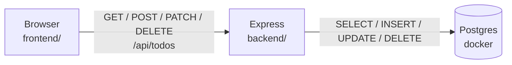

# M8 · Rapport og opprydding

**Måldag:** 8 · **Branch:** `m8-report` · **Kjerne ≈** 3 t · **Resten:** buffer

## Smerten

> Om tre måneder husker du ingenting av dette. Framtids-deg prøver å starte appen og aner ikke hvordan. Og skolen vil ha en rapport.

I dag skriver du for framtids-deg, for skolen og for den neste som forker dette repoet.

## Mål

Repoet ditt kan forstås og startes av noen som aldri har sett det. Rapporten er skrevet. Koden er ryddet. Alt er merget.

## Nye begreper

- **README**: den første fila alle leser. Hva er dette, hvordan starter jeg det, hvordan er det bygd.
- **arkitekturskisse**: bokser og piler. Nettleser, server, database, og hva som går mellom dem.
- **Mermaid**: tegn diagrammer med tekst. GitHub viser dem som bilder.
- **refaktorering**: endre koden uten å endre hva den gjør, så den blir lettere å lese. Git er sikkerhetsnettet.
- **retrospektiv**: se tilbake. Hva funket, hva funket ikke, hva gjør vi annerledes.

## Oppgaver

- [ ] 8.1 **Ta igjen.** Alt som er uavkrysset i kjernen til M5 og M6 gjøres først. Rapporten venter.
- [ ] 8.2 **README i din fork.** Skriv om `README.md` så den handler om *din* app: hva den gjør, et skjermbilde, «Slik kjører du» med `docker compose up --build`, og en liste over API-rutene med lenke til `/docs`. Norsk er greit, engelsk er bonus. Commit.
- [ ] 8.3 **Arkitekturskisse.** Et Mermaid-diagram i README-en med tre bokser og pilene mellom dem, med HTTP-metodene på pilene. Skjelett under. Se at GitHub tegner det. Commit.
- [ ] 8.4 **Rydd.** Gå gjennom hver fil. Slett utkommentert kode. Slett `console.log` du ikke trenger. Gi funksjoner og variabler navn som sier hva de er. Hver funksjon gjør én ting. Appen skal virke akkurat som før, det er hele poenget. Commit etter hver fil.
- [ ] 8.5 **Rapporten.** Kopier `rapport/RAPPORT-MAL.md` til `rapport/RAPPORT.md` og fyll ut. Loggen din er råstoffet. Egne ord. Claude kan stille deg spørsmål, men ikke skrive den. Commit.
- [ ] 8.6 **Retrospektiv med veileder.** Tjue minutter. Tre ting du ville gjort annerledes, det vanskeligste, det morsomste. Skriv konklusjonen inn i rapporten. Push, PR, merge. Ferdig.

### Skjelett til arkitekturskissen

## Ferdig når

- [ ] En kollega kan klone forken din, kjøre to kommandoer fra README-en og bruke appen
- [ ] Diagrammet vises på GitHub
- [ ] Ingen utkommentert kode, ingen funksjoner som gjør tre ting
- [ ] `rapport/RAPPORT.md` er skrevet, med alle avsnitt
- [ ] Alle branches er merget til `main`, og `main` kjører

## Bonus

1. Ordliste bakerst i rapporten: ti begreper forklart med egne ord, uten å slå opp
2. `CONTRIBUTING.md`: hvordan ville du forklart arbeidsmåten til neste elev?
3. Et tidslinjediagram i Mermaid over de åtte dagene
4. Det andre M7-sporet, hjemme

## Kontrollspørsmål

Dette er eksamen. Uten å se på koden:

1. Forklar hva som skjer fra du trykker «legg til» til raden ligger i databasen og lista er oppdatert på skjermen. Alle steg, alle tre lag.
2. Hva ville sluttet å virke hvis databasen forsvant? Hva ville fortsatt virke?
3. Hvor kjører hver del av appen? Hvilke porter, hvilke containere?
4. Hva ville du bygget neste gang, og hvilken milepæl ville du startet med?

## Ta det videre hjemme

Ingen av disse er oppgaver. De er dører.

- Legg appen på internett. Render, Fly.io og Railway har gratisnivåer med Postgres.
- Innlogging, så hver bruker har sin egen liste. Da trenger `todos` en `user_id`. Du vet hva det er nå.
- Mobilvennlig design. Åpne appen på mobilen via maskinens IP på samme nett.
- Gjør det andre M7-sporet.
- TypeScript. Når du har skrevet «strengen som trodde den var et tall» i loggen fem ganger, skjønner du hvorfor det finnes.
